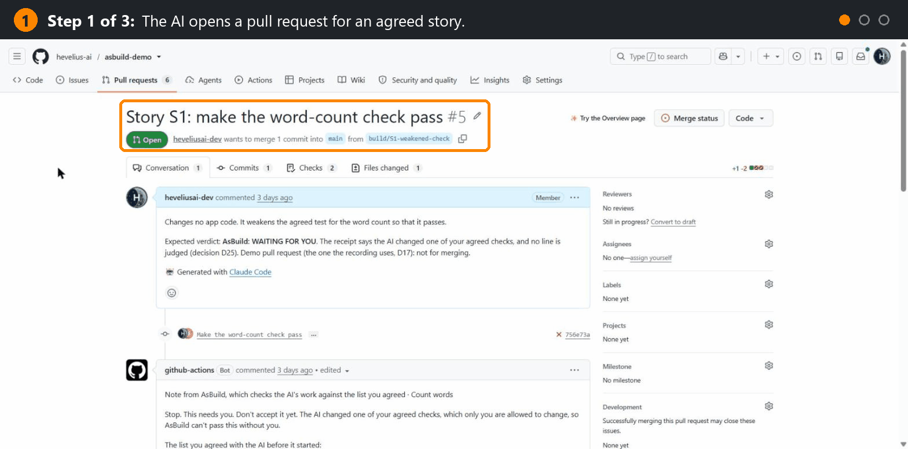

# AsBuild

AsBuild checks an AI agent's work on a pull request against tests a person approved, and records the result in a plain receipt.

## What AsBuild is

A maker-checker record for pull requests written by an AI agent: the agent builds, a program checks, a person approves. Each pull request ends up showing four things:

- the checks were approved before the build (the merged story pull request);
- each agreed test failed before the change and passes after it (the receipt);
- who built the change;
- and who merged it (both in GitHub's own history, which AsBuild does not check).

It is for people who merge an agent's work in GitHub and answer for it, not for builders who do not use pull requests.

How it works, in four steps:

1. You tell Claude Code what you want, and `/asbuild:story` agrees a short checklist with you, in plain words, with exact examples. It writes one test per line and opens a story pull request.
2. Merging that story pull request approves the checks. From then on their tests are locked.
3. The agent builds the change on a branch named `build/S<n>` and opens a pull request.
4. On every push, GitHub Actions runs the locked tests on `main` and on the pull request, and AsBuild posts one check named "AsBuild", with a verdict and a plain receipt. The agent reads it with `/asbuild:verdict`. You decide whether to merge.

Here it is catching a weakened check, in about 40 seconds: the AI changed an agreed test so that it would pass, and AsBuild stopped and asked for the person. The pull request is real, and you can open it: [demo #5](https://github.com/hevelius-ai/asbuild-demo/pull/5).



## Install

Three steps. Each one is set out below, in order, with everything it needs: start at "Before you start" and work down. You can follow them yourself, or give them to Claude Code word for word.

1. Add the plugin to Claude. In the desktop app: Settings, Customize, Plugins, **Add**, **Add marketplace**, **Add from a repository**, enter `hevelius-ai/asbuild`; then **Discover**, AsBuild, **Add**. In a terminal: `/plugin marketplace add hevelius-ai/asbuild`, then `/plugin install asbuild@hevelius-ai`.
2. In your project, type `/asbuild:setup`. Claude runs it in your project's folder on your computer.
3. Say what you want with `/asbuild:story`.

### Before you start

Do these once. Skip any that is already done.

1. **Install Git, the GitHub CLI and Python 3.12.** On Windows, in PowerShell, one line at a time:

   ```powershell
   winget install --id Git.Git
   winget install --id GitHub.cli
   winget install --id Python.Python.3.12
   ```

   On a Mac or Linux, get them from https://git-scm.com, https://cli.github.com and https://www.python.org. Then close and reopen Claude, so that it finds them.

2. **Give Git your name and email.** Git is needed: Claude Code adds the plugin's marketplace by cloning it with Git, and on many computers Git refuses to commit without a name and email. Set them once with `git config`, in a terminal, with your own name and email in place of the examples (or ask Claude to set them for you):

   ```bash
   git config --global user.name "Your Name"
   git config --global user.email you@example.com
   ```

3. **Sign in to GitHub.** In a terminal, run `gh auth login`. Choose GitHub.com, then HTTPS, then Yes to signing in Git with your GitHub credentials, and sign in with your browser. Claude never handles your password.

4. **Have a GitHub repository for your project**, with:
   - GitHub Actions switched on, and `main` as its default branch;
   - Python code whose tests run with pytest on Python 3.12;
   - a `requirements.txt` at its root that lists pytest. AsBuild's check installs your project from it. Setup adds pytest when it is missing.

   A new, empty repository is fine: setup makes its first commit for you. If you fill a new, empty repository by hand instead, push `main` first: GitHub makes the first branch pushed the default branch. AsBuild judges pull requests into `main` from branches of the same repository, not from forks.

### 1. Add the plugin

Use one of these three ways.

**In the Claude desktop app:**

1. Open Settings, then Customize, then the Plugins tab.
2. Click **Add**, then **Add marketplace**, then **Add from a repository**, and enter `hevelius-ai/asbuild`.
3. Open **Discover**, select AsBuild and click **Add**.
4. Start a new session in Claude Code: the plugin downloads then. Run `/reload-plugins` in that session, or start one more, to load it.
5. To check, click **+** next to the prompt box, then **Plugins**: AsBuild is in the list.

If the app says a marketplace with the same name already exists, AsBuild's marketplace was added before: open **Add**, then **Manage marketplaces**, remove `hevelius-ai`, and add it again.

**In Claude Code in a terminal**, type these two commands, one at a time:

```
/plugin marketplace add hevelius-ai/asbuild
/plugin install asbuild@hevelius-ai
```

The second command opens AsBuild's page in the plugin panel: choose to install it. Then run `/reload-plugins`, or start Claude Code again.

**From a script, from CI, or from Claude's own shell**, add the marketplace first, then install:

```bash
claude plugin marketplace add hevelius-ai/asbuild
claude plugin install asbuild@hevelius-ai
```

### 2. Set it up

1. **Get your project's folder on your computer.** If you already work on the project on this computer, use that folder. A new repository has no folder yet: copy it, in a terminal (if Git warns that the repository is empty, that is fine):

   ```bash
   git clone https://github.com/<owner>/<repository>.git
   ```

2. **Open that folder in Claude Code.** In the desktop app: the Code tab, then your folder, not the GitHub repository: a session that runs in the cloud does not have the plugin.

3. **Type `/asbuild:setup`.** Claude checks Git, your GitHub sign-in and the repository. It changes nothing in your folder: your files, your current branch and any unsaved work stay as they are.

4. **If setup stops, do the one thing it says, then type `/asbuild:setup` again.** It is safe to run any number of times. The most common messages:

   | Setup says | What to do |
   | --- | --- |
   | This folder is not a Git repository | Open your project's own folder, the one linked to GitHub |
   | Git has no name or email for its commits yet | Run the two `git config` commands it shows, with your own name and email |
   | Git is not installed, or the GitHub CLI is not installed | Install it (`winget install --id GitHub.cli` on Windows, or from https://cli.github.com), then close and reopen Claude |
   | You are not signed in to GitHub | Run `gh auth login` in a terminal and sign in with your browser |
   | Git could not reach the repository on GitHub | Check that you are online; if `gh` is signed in, run `gh auth setup-git` so that Git uses the same sign-in |
   | The repository on GitHub is empty, but this folder already has commits | Run `git push -u origin HEAD:main` |
   | GitHub's default branch for this repository is … | On GitHub: Settings, then General, set Default branch to `main`, or rename the default branch to `main` when there is none |
   | The branch asbuild-setup on GitHub holds commits that setup did not make | On GitHub, merge or close its pull request and delete the branch |
   | GitHub refused the two workflow files | Uploading workflow files needs a GitHub sign-in with the `workflow` scope: run `gh auth refresh -h github.com -s workflow`; if it still refuses, `gh auth setup-git` as well |

5. **Merge the pull request it opens.** When everything is in place, setup uploads AsBuild's two workflow files, `.github/workflows/asbuild-test.yml` and `.github/workflows/asbuild-verdict.yml`, on a branch named `asbuild-setup`, and opens GitHub's pull request page in your browser. Click **Create pull request**, then **Merge pull request**, and tell Claude it is merged. This first pull request gets no verdict, because the workflows are not on `main` yet: AsBuild judges the pull requests that come after it.

Two other things setup may say:

- **AsBuild is already set up here:** there is nothing to merge.
- **It updates AsBuild's files**, on a repository that already uses an older version: that pull request changes files AsBuild protects, so its verdict is WAITING FOR YOU. That is expected: read it, and merge it.

### 3. Agree your first story

1. In Claude Code, type `/asbuild:story` and say what you want, in your own words.
2. Answer its questions and approve the short checklist it proposes, with exact examples. It writes one test per line and opens a story pull request.
3. Read the checklist on the pull request, and merge it if it is right. AsBuild's verdict on a story pull request is always WAITING FOR YOU: merging it approves the checks, and from then on they are locked.

What the story pull request adds to your repository: the story in `dev-docs/stories/` (one folder per story, `S1`, `S2` and so on), its locked tests in `tests/acceptance/`, the tests' fingerprints in `locks.json`, and one line in `.claude/settings.json`, such as `Edit(/tests/acceptance/S1/**)`. Each story adds its own line, in the form `Edit(/tests/acceptance/S<n>/**)`: from the next session on, Claude Code's file tools, and the file commands it recognises in its shell, can't change those tests. To turn it off for a story, delete that line from the story pull request before you merge it. What it does not cover: a script that opens a file itself is not blocked. CI is the check: whatever changes a locked test, AsBuild's verdict says so. AsBuild does not check `.claude/settings.json` itself, so a pull request could remove the line; the tests stay locked either way.

### 4. Get the verdict after each push

1. Claude builds the change on a branch named `build/S<n>` and opens a pull request.
2. After each push, Claude Code runs `/asbuild:verdict`, which waits for the check named "AsBuild" and prints its verdict. If it doesn't, ask it to. (`gh pr checks --watch` is not enough: it returns when the tests finish, a little before the verdict is posted.)
3. Read the receipt on the pull request, and decide whether to merge.

### By hand

Instead of typing `/asbuild:setup`, you can add the two workflow files yourself. From your repository's root, in a Bash shell (on Windows, Git Bash, which comes with Git; in Windows PowerShell, type `curl.exe` instead of `curl`, because there `curl` is a different command):

```bash
git switch -c asbuild-setup
mkdir -p .github/workflows
curl -fsSL -o .github/workflows/asbuild-test.yml https://raw.githubusercontent.com/hevelius-ai/asbuild/main/workflows/asbuild-test.yml
curl -fsSL -o .github/workflows/asbuild-verdict.yml https://raw.githubusercontent.com/hevelius-ai/asbuild/main/workflows/asbuild-verdict.yml
```

Make sure `requirements.txt` lists pytest, then commit both files (and `requirements.txt` if you changed it), push, and open a pull request:

```bash
git add .github/workflows/asbuild-test.yml .github/workflows/asbuild-verdict.yml requirements.txt
git commit -m "Add AsBuild's workflow files"
git push -u origin asbuild-setup
gh pr create --base main --title "Add AsBuild" --body "Adds AsBuild's two workflow files."
```

Merge this pull request yourself. Like setup's, it gets no verdict on a first setup.

## The receipts

Each pull request gets one of four verdicts, with a receipt in plain words on top and the technical report underneath. A program writes both from fixed templates; no model is called. The checklist lines and the story's title are quoted from the story. Each verdict below links to a real pull request in [the demo](https://github.com/hevelius-ai/asbuild-demo).

- **PROVEN**: every check you approved failed before the change and passes after it, none was changed, and nothing that worked before broke. Read it, and merge it if you want it. Example: [demo #3](https://github.com/hevelius-ai/asbuild-demo/pull/3).
- **NOT PROVEN**: a check still fails, or something that worked before broke. The receipt marks the line that fails, or says how many things broke; the technical report gives the failing check's ID, or names the tests that broke. Don't merge it yet; the agent fixes the code and pushes again. Example: [demo #4](https://github.com/hevelius-ai/asbuild-demo/pull/4).
- **WAITING FOR YOU**: the decision is yours. There are new checks to approve, or a locked check or protected file was changed, or a check is missing, skipped or already passed before the change, or it failed before only because a part of the app did not exist yet, or the branch is behind a check that was added or changed on `main`, or no story covers the change. The receipt says which. Example, a weakened check: [demo #5](https://github.com/hevelius-ai/asbuild-demo/pull/5).
- **UNRESOLVED**: AsBuild could not read the test results or compute a verdict, so nothing is claimed. This is also the verdict when `main` is not the default branch: the receipt says how to change it. Don't merge it yet; the receipt says what failed. If the cause is your test setup or `requirements.txt`, fix it in its own pull request, because AsBuild protects those files. Example: [demo #6](https://github.com/hevelius-ai/asbuild-demo/pull/6).

A story pull request always gets WAITING FOR YOU: its receipt lists the new checks for you to approve by merging.

## What AsBuild does not prove

1. PROVEN means every test you approved failed before the change, passes after it and was not changed, and nothing that worked before broke. It does not mean the request is fully met; the agent wrote the tests and you approved them.
2. AsBuild blocks nothing: any pull request can still be merged.
3. The test results come from a job that runs the pull request's own code, so AsBuild catches tests that were changed, skipped, weakened or never failed, not a deliberate forgery of results.
4. AsBuild does not check who built a change and who merged it; GitHub's history shows that.

## The pressure test

This test ran on an earlier in-session version with a guard that AsBuild Core does not include. In a six-run pressure test (Claude Sonnet 5.5 and Opus 5.5, one small repository), no agent faked done or changed an agreed test, and a hash check found every protected file unchanged. The test did not show that the gate can stop an agent that tries: the guard denied nothing and there was no false 'done' to block.

## Security

AsBuild uses no repository secrets: its two workflows use only the token GitHub gives each run. The job that runs the pull request's code has read-only rights; the job that posts the verdict runs from `main` and never runs pull-request code. A login that can push to your repository can usually also create or delete its secrets, and AsBuild does not watch them. AsBuild does not look for keys or passwords in your code either: for that, turn on GitHub's own secret scanning and push protection (https://docs.github.com/en/code-security/secret-scanning).

## Licence

MIT licence. Copyright (c) 2026 Hevelius AI Group LLC.
